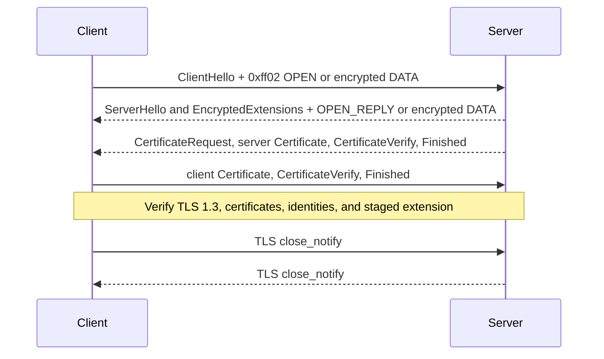

# BrushPass protocol: native profile v2

**Status:** experimental implementation profile; not an Internet standard and not independently audited.

This document describes the wire behavior implemented by the native C BruSHpass tool.

BrushPass carries bounded encrypted protocol messages in TLS 1.3 handshake extensions. BruSHpass uses those messages for a remote-administration command queue. Protocol confidentiality does not make the extension or connection pattern covert: the extension number and the `BP2\0` marker are identifiable.

## 1. Participants and scope

- **Client:** an exported, individually provisioned Windows x64 or Linux x64 BruSHpass executable. It initiates outbound connections to its configured server.
- **Server:** the BruSHpass listener and operator console.
- **Topology:** direct client-to-server TCP/TLS connection. The profile defines no mailbox relay or peer discovery.
- **Transport:** TLS 1.3 only, with mutual certificate authentication on every physical connection.
- **Message carrier:** extension `0xff02`, in ClientHello from client to server and EncryptedExtensions from server to client.
- **Application data:** the native application does not call `SSL_write` to carry commands or output. TLS record-layer outer content type 23 (`Application Data`) can still wrap encrypted TLS handshake messages; that label does not identify the inner handshake content.
- **Limits:** 512 bytes per command/body, 16 KiB output per command, 32 client sessions, and 64 queued frames per session. This is not a bulk-transfer or interactive terminal protocol.

Extension `0xff02` is a private-use TLS extension value, not a registered BrushPass assignment. Implementations must consider collision risk when used outside a controlled environment.

## 2. Physical connection and handshake flow

Each exchange uses a new, full TLS 1.3 handshake. Session resumption, session tickets, and early data are disabled. The application data frame is protected by BrushPass AES-GCM keys, independently of the TLS record encryption.

The sequence is schematic; TLS 1.3 message order and encryption boundaries are defined by [RFC 8446](https://www.rfc-editor.org/rfc/rfc8446.html). The custom extension is registered only for ClientHello and TLS 1.3 EncryptedExtensions contexts. The server response extension is protected by TLS handshake traffic keys. The client extension in ClientHello is observable, which is why it contains only public setup metadata or independently encrypted BrushPass data.

Extension parsing stages data only. A peer does not act on staged content until its TLS handshake has completed and the certificate identity is authorized. The client additionally requires the server's TLS shutdown to complete cleanly before accepting the response. The server commits a received frame after successful mutual TLS authentication; its EncryptedExtensions response is necessarily constructed before the client certificate has been verified, so that response cannot acknowledge the current client frame.

For HelloRetryRequest, the client reuses the exact same ClientHello extension bytes. The implementation does not implement resumption or an alternate application-data fallback.

## 3. Identity and key establishment

### 3.1 Provisioning and authentication

The server creates or loads one retained identity file, `brushpass-identity.pem`. It contains a private CA key and certificate plus a server private key and certificate. The PEM is currently unencrypted and depends on restrictive owner permissions. Clients must be reprovisioned if this identity changes.

Each client export generates a random 16-byte client ID, an individual P-256 EC private key, and a client certificate signed by the server's private CA. The client certificate Common Name is the 32-character lowercase hexadecimal client ID. The client binary embeds its private key, client certificate, CA certificate, server endpoint, and exact SHA-256 fingerprint of the server certificate. Exported client binaries are therefore private credentials.

On every connection:

1. The server validates the client certificate chain to its CA and requires its Common Name to equal the client ID in the extension.
2. The client validates the server chain to its embedded CA and compares the peer certificate's SHA-256 digest to its embedded exact certificate pin. It does not rely on hostname matching.
3. Both require a full TLS 1.3 handshake. Resumed TLS sessions are rejected.

### 3.2 Initial session setup

An inactive client creates a cryptographically random 16-byte client nonce and sends an `OPEN` extension. The server returns a cryptographically random 16-byte session ID and echoes the nonce in `OPEN_REPLY`. These fields are public and contain no command or output. The server may prepare the reply before it authenticates the client, but it creates/replaces any application session only after successful mTLS and the client-ID binding check.

After both parties complete the setup TLS handshake, they independently call the TLS exporter with:

| Parameter | Value |
| --- | --- |
| Label | ASCII `EXPORTER-BrushPass-v2` (no terminating NUL) |
| Context | `client_id[16] || client_nonce[16] || session_id[16]` |
| Output | 64 bytes |

The first 32 bytes are the client-to-server AES-256-GCM key. The next 32 bytes are the server-to-client key. TLS exporter output is tied to the completed TLS handshake, whose ephemeral key agreement and mutual certificate authentication bind it to both peers and the negotiated handshake. Each logical BrushPass session retains these keys in memory. Later physical TLS handshakes transport frames encrypted under the logical session keys; they do not derive a new BrushPass key for each poll.

There is no static shared message key. A newly authenticated `OPEN` creates fresh session keys and replaces any previous session for that client ID. A reconnect after loss of session state performs a new `OPEN` and exporter derivation.

## 4. Extension envelope

All integer fields are unsigned and big-endian. The 47-byte outer header is:

| Offset | Size | Field | Meaning |
| ---: | ---: | --- | --- |
| 0 | 4 | Magic | ASCII bytes `BP2\0` |
| 4 | 1 | Type | `OPEN=1`, `OPEN_REPLY=2`, `DATA=3` |
| 5 | 16 | Client ID | Per-client identifier |
| 21 | 16 | Session ID | All zero in `OPEN`; current session otherwise |
| 37 | 8 | Transmission counter | Zero for setup; nonzero for `DATA` |
| 45 | 2 | Payload length | Exact number of bytes following the header |

### 4.1 Setup payloads

`OPEN` has exactly 16 payload bytes: the client nonce. Its session ID and transmission counter are zero. `OPEN_REPLY` has exactly 16 payload bytes: the echoed nonce. It carries the server-generated session ID and a zero transmission counter. The client verifies type, client ID, nonce, and lengths before completing setup.

### 4.2 Encrypted DATA payload

The DATA payload is AES-256-GCM ciphertext followed by its 16-byte authentication tag. The plaintext frame header is 31 bytes:

| Offset | Size | Field |
| ---: | ---: | --- |
| 0 | 8 | Frame ID |
| 8 | 8 | Acknowledgment ID |
| 16 | 8 | Command ID |
| 24 | 4 | Chunk index |
| 28 | 1 | Kind |
| 29 | 2 | Body length |
| 31 | 0–512 | Body |

The body length must match the plaintext and outer-envelope sizes exactly. The entire 47-byte outer header is AES-GCM associated data (AAD), so the client ID, session ID, type, transmission counter, and payload length are authenticated. Maximum encoded DATA extension size is 47 + 31 + 512 + 16 = 606 bytes, below the implementation's 1024-byte wire buffer.

Kinds:

| Kind | Name | Rules |
| ---: | --- | --- |
| 0 | Poll | Frame ID, command ID, chunk index, and body length are zero |
| 1 | Command | Nonzero frame and command IDs; 1–512 bytes; NUL is forbidden |
| 2 | Output | Nonzero frame and command IDs; 0–512 bytes |
| 3 | Done | Nonzero frame and command IDs; body is exactly a 4-byte exit status |

Commands and output are byte strings interpreted by the receiving implementation. BruSHpass treats command bytes as a platform shell command. `cd` is handled as a client-side builtin to preserve the session working directory. Other commands execute as bounded, non-interactive child processes.

## 5. Nonce, counters, replay, and acknowledgments

Each direction has an independent key and monotonically increasing transmission counter. The 96-bit GCM nonce is four zero bytes followed by the 64-bit big-endian counter. Counter zero is forbidden for DATA. A counter is advanced whenever an outbound frame is encrypted, including when the same logical frame is retried. Thus retransmission uses the same frame ID and content but a new counter/nonce. The receiver rejects counters not greater than the highest committed counter for that direction/session. Counter gaps are allowed because an encrypted exchange may fail before being accepted.

Frame IDs are separate from transmission counters. Each side assigns increasing IDs to its queued non-poll frames. The receiver accepts the next expected frame, or an identical duplicate of the latest accepted frame; duplicate content must match kind, command ID, chunk index, body length, and body. A duplicate is not delivered or executed twice. A later DATA frame can carry the acknowledgment again.

The acknowledgment field refers to a frame previously accepted from the opposite direction. A sender removes its acknowledged queue head only after receiving an authenticated acknowledgment. A `DATA` response generated before the server authenticates the client's current handshake cannot acknowledge the frame from that same request. It can acknowledge earlier client frames. A client does not accept a response until the server handshake and TLS shutdown checks pass.

The implementation stores counters, last accepted frame, queue, and session keys only in memory. A failed client exchange discards that client's session and pending results, restores the client's initial working directory, and reconnects after a backoff. The server expires inactive sessions after 60 seconds. A fresh authenticated `OPEN` replaces existing state. `drop <client-id>` discards a session and its queues. Message state is not restored after process restart.

Delivery is not exactly-once for external effects. If a command ran but its output or completion frame was lost, the operator may not know its outcome; a fresh session does not automatically replay the discarded command. Filesystem and other effects performed by commands are not rolled back.

## 6. Command and response lifecycle in BruSHpass

1. The operator selects a connected client with `use <id>` or addresses it with `send <id> <command>`.
2. The server queues a command frame. Commands for one client are serialized: the next command is held until the prior command's completion is received.
3. The client polls. Once a new authenticated command frame is committed, the client executes it as the current user. Linux uses `/bin/sh -c`; Windows uses `cmd.exe /D /S /C`.
4. Standard output and standard error are combined. Input is disconnected; there is no PTY or interactive stdin.
5. Output is capped at 16 KiB and returned in 512-byte frames, followed by a completion frame containing the four-byte exit status.
6. Execution has a 15-second limit. Wrapper statuses are 124 for timeout, 125 for truncated output, and 126 for execution setup failure. Linux timeout handling terminates the child process group; Windows uses a kill-on-close Job Object.

The server handles connections sequentially in the current implementation. A slow handshake can delay other clients. These limits and the absence of a production admission-control and revocation system are material implementation constraints.

## 7. Security properties and limitations

The profile aims to provide confidentiality and integrity for DATA bodies, peer authentication through mTLS plus a pinned server certificate, per-client credentials, per-session directional keys, and bounded duplicate/replay handling while a session remains in memory.

It does not provide:

- traffic hiding, protocol indistinguishability, or resistance to extension-based detection;
- durable queues, message history, exactly-once command effects, or state recovery after process failure;
- key revocation lists, individual client revocation, automated identity rotation, or encrypted-at-rest server identity storage;
- a PTY, interactive stdin, file transfer, relay service, or IPv6 support;
- independent security review or a production security guarantee.

The unencrypted retained server identity file can impersonate the server and mint client certificates if stolen. An exported client binary contains its client private key and should be treated accordingly. The pinned server certificate permits the endpoint to be an IP address, but changing the server identity requires re-exporting clients. Network observers can identify the extension and its message cadence even though DATA is encrypted.

## 8. References and project documents

- [TLS 1.3, RFC 8446](https://www.rfc-editor.org/rfc/rfc8446.html)
- [OpenSSL TLS exporter API](https://docs.openssl.org/3.6/man3/SSL_export_keying_material/)
- [OpenSSL custom TLS extension API](https://docs.openssl.org/3.6/man3/SSL_CTX_add_custom_ext/)
- [BruSHpass build and operator guide](docs/native.md)
