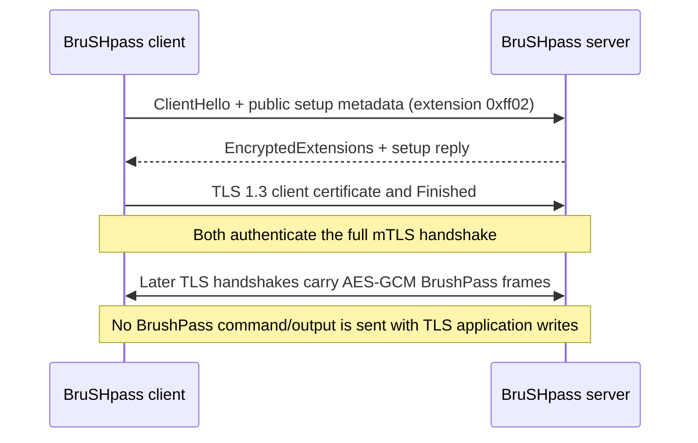

<div align="center">


# BruSHpass

### A native C implementation of the BrushPass TLS 1.3 handshake messaging protocol

**Two peers. One authenticated handshake. Encrypted, bounded messages.**


</div>

---

## What it is

**BrushPass** is an experimental protocol for carrying encrypted, application-defined messages in permitted TLS 1.3 handshake extensions. **BruSHpass** is a native C remote administration tool built on that protocol. Its server accepts authenticated client connections, queues bounded commands in memory, and receives their output in the same encrypted extension channel.

It has not received an independent security audit. The custom extension and connection pattern are visible protocol identifiers; BrushPass makes no traffic-concealment or indistinguishability claim. Use only on systems and networks you own or are authorized to administer.

The current native profile uses mutual TLS 1.3, per-client certificates, a pinned server certificate, TLS exporter-derived directional keys for each logical session, and AES-256-GCM message frames. Message queues and session state live in memory. A retained server identity credential is needed so already-exported clients can trust the server after restart.

## Handshake at a glance



The initial ClientHello contains only a client identifier and random setup nonce. After mutual certificate authentication completes, both peers derive separate directional message keys from the TLS exporter. Commands and output are sent in later handshake extensions. TLS 1.3 packet captures label encrypted handshake records as `Application Data` at the record layer; that label alone does not mean the program sent application messages.

## Quick start

Prebuilt Windows x64 and Linux x64 servers are published with the source in the release bundle. Each server embeds both client templates and can provision either client platform. Clients make an outbound connection to the configured server.

Start the server on your host (replace the example address with your server address):

```powershell
.\BruSHpass.exe -i 192.0.2.10 -p 8443
```

```bash
chmod +x ./BruSHpass
./BruSHpass -i eth0 -p 8443
```

At the server console, export a unique client executable. Supply the address the client can reach:

```text
export-client linux-x64 linux-client 192.0.2.10
export-client windows-x64 windows-client.exe 192.0.2.10
```

Transfer the resulting binary over a trusted channel. On Linux, mark it executable and run it; on Windows, run the `.exe`. Then use `clients`, `use <client-id>`, and enter a command. See the [operator guide](docs/native.md) for firewall, session, command, and identity details.

## Build from source

The checked-in PowerShell build script reproduces the project's Windows and Linux x64 release builds. It needs Windows, Visual Studio 2022 C/C++ tools, CMake, Python 3, vcpkg with the pinned static OpenSSL triplet, Zig 0.15.2, and the Linux/musl OpenSSL static archives prepared under `.native-deps`. The exact versions and OpenSSL configuration are listed in [`native/dependencies.json`](native/dependencies.json). Dependencies are deliberately not vendored.

From a Visual Studio developer PowerShell, after installing/preparing those dependencies:

```powershell
.\tools\build_native.ps1
```

The script builds provisionable client templates first, embeds them into each server, runs the native protocol self-test, and writes outputs under `dist/BruSHpass-release/`. Runtime clients and servers require neither Python nor OpenSSL DLLs. The release includes `templates/` for rebuilding but the distributed servers do not need sidecar templates to export clients.

For a single-platform development build, CMake requires a C11 compiler, OpenSSL 3.0 or later, and Threads. Build an unprovisioned client template with `-DBP_CLIENT_TEMPLATE=ON`; it deliberately refuses to run until the server provisions it. A normal CMake build without both embedded templates is a development server and cannot export clients. See the [detailed build guide](docs/native.md#building-and-validation).

## Security and operating limits

- Exported client binaries contain unique private client credentials. Treat each as a secret; provision one per authorized machine and do not publish them.
- `brushpass-identity.pem` contains the server CA and server private keys. Protect and back it up securely. The current PEM is unencrypted, relying on restrictive file permissions.
- The native tool has no persistence, automatic startup, or service installation. Commands run visibly as the client process's current user and privileges.
- Queues, replay counters, output, and session keys are memory-only. A failed exchange discards pending state; a command may have run even when its reply is lost.
- Commands are bounded, non-interactive subprocesses, not a PTY. There is no stdin channel, file transfer, per-client revocation registry, or independent security review.
- The Linux artifact is cross-compiled for x86_64 musl. Test it on the intended Linux distribution before relying on it; this repository's Windows-host validation does not establish Linux runtime behavior.

## Documentation

- [Protocol.md](Protocol.md) — implemented native BrushPass v2 wire format, key establishment, authentication, replay and acknowledgment behavior, and known limits.
- [Native build and operator guide](docs/native.md)


## License

No top-level project license has been selected yet. Third-party runtime/build notices are included in the release bundle's `licenses/` directory. Add a project license before redistributing source under an assumed open-source license.

